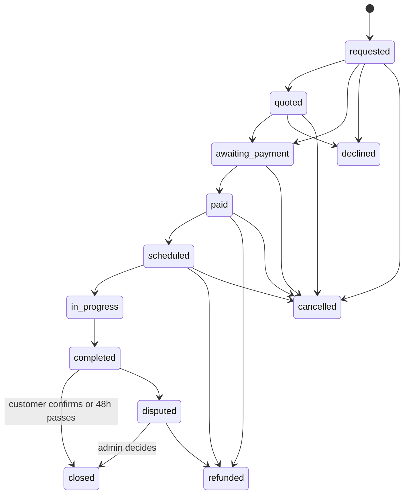

# Database

Postgres on Supabase. The whole schema is plain SQL in [`supabase/migrations`](../../supabase/migrations), applied in numeric order. It has been run end to end against Postgres 16 with a test suite of 109 checks.

| Document | What it is |
| --- | --- |
| [erd.md](erd.md) | Entity relationship diagram (generated) |
| [data-dictionary.md](data-dictionary.md) | Every table and column (generated) |
| [local-setup.md](local-setup.md) | Run the database in Docker |
| This file | How the schema is organised, who can do what, how money moves |

## Migrations

| File | Contents |
| --- | --- |
| 0001_types | Enums |
| 0002_identity_companies | Profiles, admins, service areas, addresses, companies, members, verification documents |
| 0003_catalog_units | Service types, company price lists, customer units |
| 0004_bookings_quotes | Bookings, items, unit access grants, quotes, messages |
| 0005_job_reports_reminders | Job reports (append-only once final), parts, photos, service reminders |
| 0006_payments_disputes_reviews | Payments, payouts, ledger, disputes, reviews |
| 0007_subscriptions_platform | Plans, subscriptions, invoices, settings, notifications, audit log |
| 0008_functions_triggers | Helpers, state machine, pricing, payments and payout logic, disputes |
| 0009_rls_policies | Views, admin functions, row-level security, grants |
| 0010_reference_data | Service types, plans, settings, sample Klang Valley areas |

## Rules the database enforces

These hold for every client, including a buggy or malicious one.

- **The customer owns the unit record** ([ADR-0001](../decisions/ADR-0001-customer-owns-unit-record.md)). A company reads a unit only while it holds an access grant, and a grant exists only because of a booking ([ADR-0002](../decisions/ADR-0002-contractor-access-by-booking.md)). After the job closes the customer can revoke it with `revoke_unit_access`.
- **Booking status moves only through `transition_booking`** (and the quote, dispute and payment functions). Clients have no write access to the status column, and a trigger rejects any jump the graph does not allow.
- **Prices come from the company's price list.** A customer cannot set an item price. Repairs, gas top-ups and installations go through a quote.
- **A booking is paid only when held payments cover the total.** The commission rate is copied onto the booking at that moment, so later plan changes do not alter it.
- **A booking cannot complete without a final job report for every unit.** Final reports cannot be edited or deleted by anyone. A correction is a new report that supersedes the old one, and the unit history shows only the latest.
- **The ledger is append-only.** A settled booking sums to zero.
- **Payouts** are `gross − commission − fee`. A dispute freezes them.

## Booking status graph



## Who can do what

| Data | Customer | Company owner / dispatcher | Technician | Platform admin | Visitor |
| --- | --- | --- | --- | --- | --- |
| Own profile, addresses, units | Full | n/a | n/a | Read | None |
| A customer's unit | Own only | Read while granted | Read while granted | Read | None |
| Unit history (final reports) | Own units | Granted units | Granted units | Read | None |
| Draft job report | None | Own company | Author | Read | None |
| Bookings | Own | Own company | Assigned jobs | Read | None |
| Quote | After it is sent | Create, send | None | Read | None |
| Customer contact details | Self | Open booking plus 30 days | Assigned jobs | Read | None |
| Payments | Own | Own company | None | Read | None |
| Payouts and ledger | None | Owner only | None | Read | None |
| Who viewed a unit | Own units | Own company's activity (owner) | None | Read | None |
| Verified company profile, services, reviews | Read | Own company, edit | Read | Full | Read (limited view) |
| Verification status, ratings, commission | Read only | Read only | Read only | Admin functions | None |

Row-level security enforces this. Application code never needs to filter by user.

## Money

- All amounts are integers in **sen**. There are no floating-point amounts.
- Commission is stored as **basis points** (1500 = 15%) and snapshotted per booking.
- Ledger entries: `payment_received` (+), `commission` (−), `gateway_fee` (−), `payout` (−), `refund` (−). The `booking_ledger_balance` view shows what is still owed; zero means settled.
- Example from the tests: RM110 booking at 15% pays the contractor RM93.50 and the platform keeps RM16.50.

## Backend-only actions

The app server (Supabase `service_role`) must run these. Clients cannot call them.

| Action | When |
| --- | --- |
| Record a payment, set it `held` | Gateway webhook confirms payment |
| `transition_booking(..., 'paid')` | After the payment is held |
| `queue_payout(booking_id, fee_sen)` | After a booking is closed and not disputed |
| Mark a payout `paid` | After the bank transfer |
| `auto_close_completed_bookings()` | Scheduled, e.g. hourly (pg_cron or a cron-triggered edge function) |
| Send reminders and notifications | Scheduled |

## Run the tests

```
PGHOST=/tmp/pgtest PGUSER=pgtest bash supabase/tests/run_local.sh
```

Needs a local Postgres 15 or newer and a superuser. The script creates a scratch database, loads stand-ins for Supabase's `auth` schema and roles, applies the migrations, runs the tests and drops the database. Nothing touches a remote project.

## Applying to Supabase

Not done yet. When ready: run `supabase init` in the project root to create `config.toml`, link the project, then `supabase db push`. Try it on a branch or a throwaway project first.

## Not covered by this schema

- Storage bucket policies for photos and documents. The tables store file paths; buckets need their own policies.
- The payment gateway integration and webhooks.
- Notification delivery (WhatsApp, email, push). Rows are queued in `notifications`.
- Service tax and e-invoicing fields. These need professional advice first (see ADR-0004).
